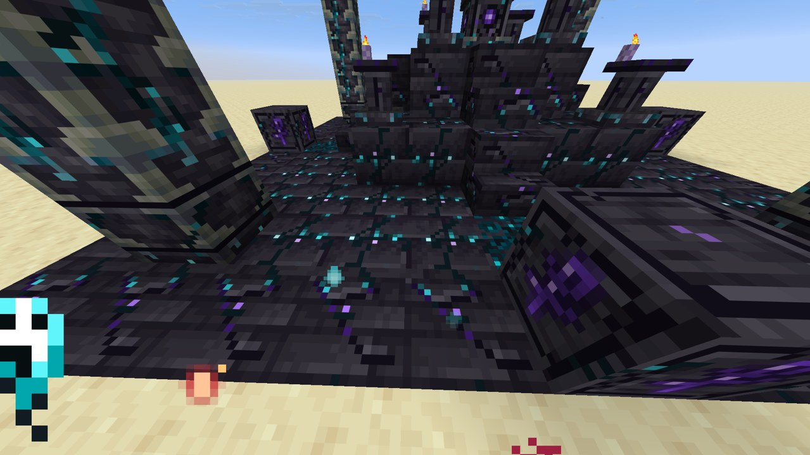
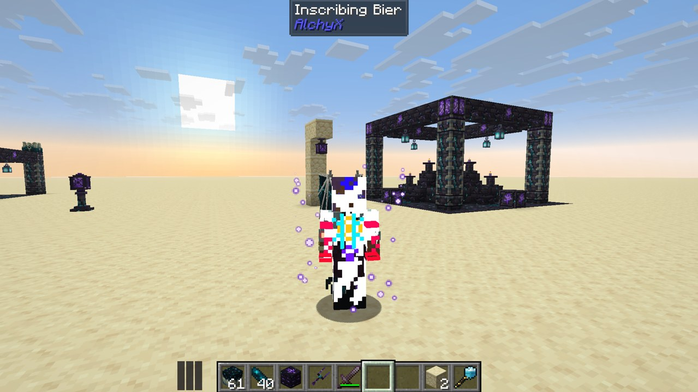

# AlchyForbidden

A dark magic mod for NeoForge (Minecraft 26.1.2), built on [AlchyX](https://github.com/JustAlex14/AlchyX). Carve an altar in the deep dark, set the Rift Eye on it, and feed it griefs: the rift grows every multiblock for you, tier by tier, its parts flying out of a great tear in the air. Then carve the rift into your own body, bind spells into rings, and call creatures out of the void to fight for you.



- **The Rift Altar and the Rift Eye**: build the first tier by hand, set the eye on it, and the rift grows the rest. Altar rites on offering stands make everything else
- **Three essences**: Wrath from killing, Sorrow from the dark and from mourning, Sculk Corruption from deaths beside a catalyst, carried in vessels or stored in the altar
- **Essence sources**: the Echo Resonator (pearls thrown round shriekers, a dead warden drained at the last tier), the Killing Pit and the Lament Well, linked to altars through Echo Obelisks with the Attuning Fork
- **Weeping Fountain**: weeps echo shards, crying obsidian, ghast tears, catalysts and the mod's own ritual components
- **Rift Knot**: knotted spawners fold their mobs into stacks of up to 64, loot rolled per mob
- **Inscribing Bier**: lie down and carve your body, 46 carvings over seven body parts (wings, sky walking, double leap, vein mining, second breath...)
- **Binding Circle**: 31 spells imbued into rings, gems for cost, cooldown, damage, duration and range
- **Rift Maw**: call 11 rift creatures into an arena you cannot leave and bind them by killing them; the last four are bosses fought in a void dimension, alone or with friends. Familiars level up, learn traits and moves, and come altered with affixes
- **Grimoire of the Deep**: an in-game book (Patchouli) told as the mage's story, its chapters opening as you go deeper

## Screenshots

<table>
<tr><td width="50%"><br><b>Grown by the rift</b>: every part after the first tier comes out of a tear in the air</td><td width="50%"><br><b>Inscribing Bier</b>: where the rift is carved into the body</td></tr>
</table>

## Requirements

- NeoForge 26.1.2
- [AlchyX](https://github.com/JustAlex14/AlchyX) 0.3.0 or newer
- Optional: Patchouli (the grimoire), JEI (rites, carvings, spells, creatures and every machine's page), Jade

## Configuration

`config/alchyforbidden-common.toml` sets every cost, rate and limit: what each multiblock tier asks for, how much each source makes, the fountain's products, every spell (tier, costs, cooldown, power), carving upkeep, the Rift Maw's odds and arenas. On a server it is sent to the players, so screens and tooltips show the server's numbers.

## Building

AlchyX must sit next to this folder (`../AlchyX`): Gradle builds it together with this project.

```
./gradlew build
```

The jar ends up in `build/libs`.

## License

MIT, see [LICENSE](LICENSE).

A few textures are recolored from Minecraft and Patchouli textures; those stay under their original owners' terms.
